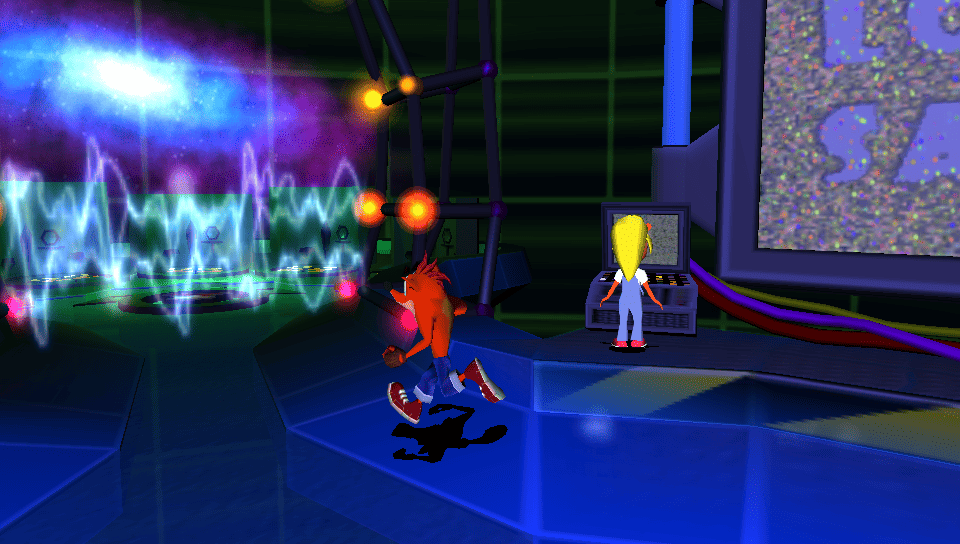
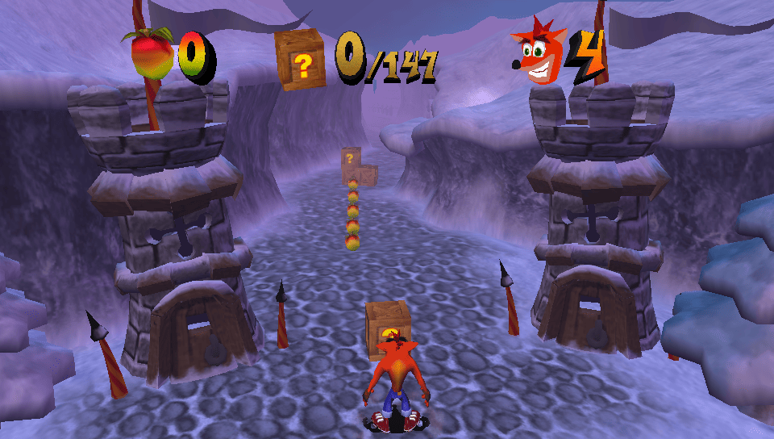
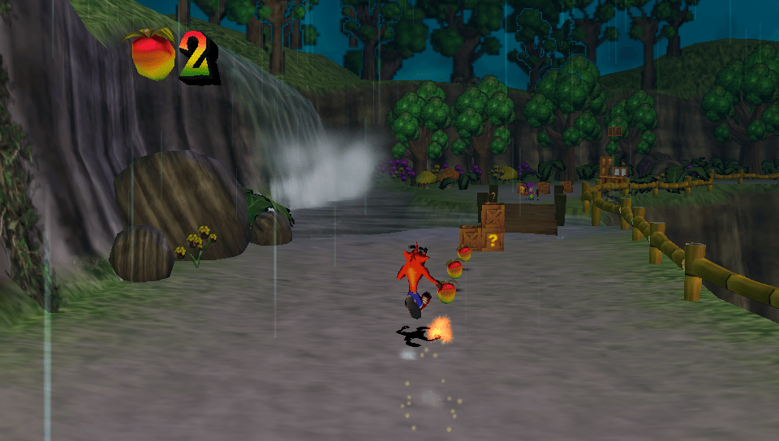
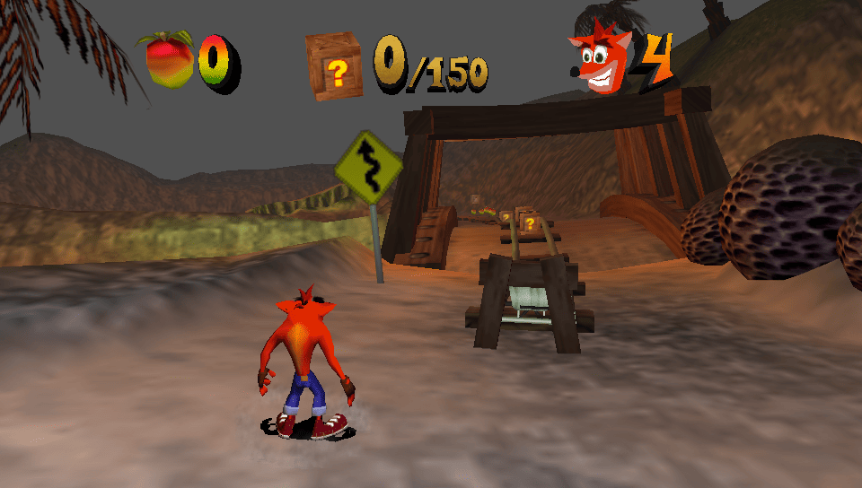
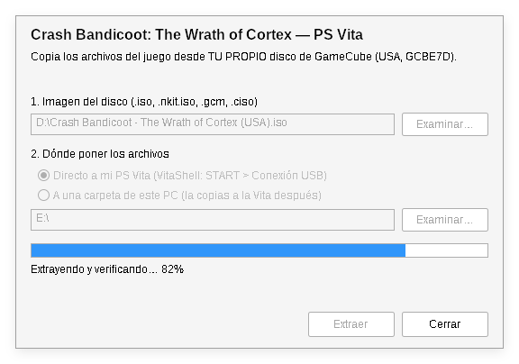
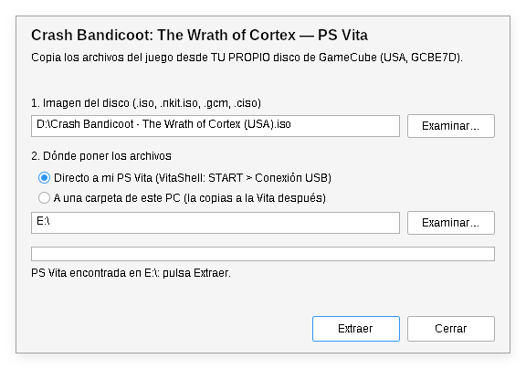
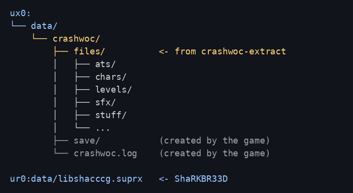

# Crash Bandicoot: The Wrath of Cortex — port para PS Vita

Port nativo **no oficial** de *Crash Bandicoot: The Wrath of Cortex*
(GameCube) para PS Vita, hecho sobre el decompilado de la comunidad. Necesitas
tu propia copia del juego: este proyecto **no incluye archivos del juego**.

[English](README.md)

| | |
|---|---|
|  |  |
|  |  |

## Estado: beta

- Se puede jugar el juego completo: hub, niveles, rondas bonus, jefes,
  vehículos (robot, carrito de mina, buggy, planeador...), partidas guardadas,
  música y sonido.
- 30–60 fps según la zona. Las escenas cargadas (muchos enemigos, partículas,
  vapor) pueden bajar de 30; **Select + abajo** bloquea los fps para un ritmo
  más parejo.
- *Crash Blast* (el minijuego de Game Boy Advance por cable link del menú
  principal) no está disponible: la Vita no tiene GBA.
- Problemas conocidos: puede que algunas plataformas aplastadoras de *Earth
  Crisis* (`a\earth_r`) no aparezcan; cargar un nivel tarda unos 8–13 s.
- Los reportes de bugs y de rendimiento son bienvenidos (ver
  [Reportar problemas](#reportar-problemas)).

## Qué necesitas

- Una PS Vita o PS TV con **HENkaku / Enso** y **VitaShell**.
- **libshacccg.suprx** en la consola (vitaGL compila los shaders al vuelo). Si
  nunca lo instalaste, usa
  [ShaRKBR33D](https://github.com/Rinnegatamante/ShaRKBR33D): instala su VPK,
  ábrelo una vez y extrae `ur0:data/libshacccg.suprx`.
- Tu propio volcado del **disco de GameCube versión USA** (ID `GCBE7D`):
  `.iso`, `.gcm`, `.nkit.iso` o `.ciso`. Si es RVZ/WIA/GCZ, conviértelo antes
  a ISO en Dolphin (clic derecho > *Convertir archivo...* > *ISO*).
- Cerca de **1 GB** libre en `ux0:`.

## Instalación

1. **Descarga** de [Releases](../../releases): `crashwoc.vpk` y el extractor
   para tu PC (`crashwoc-extract.exe` en Windows, `crashwoc-extract-linux` o
   `crashwoc-extract-macos`).
2. **Extrae los archivos del juego**: abre `crashwoc-extract.exe` (doble clic).
   1. **Imagen del disco**: pulsa *Examinar…* y elige tu imagen (o arrastra la
      imagen sobre el `.exe`).
   2. **Dónde poner los archivos**:
      - *Directo a mi PS Vita*: en VitaShell pulsa **START > Conexión USB** y
        conecta la Vita; el extractor encuentra su memoria (`ux0:`) solo, o
        pulsa *Examinar…* y elige su unidad. Los archivos quedan en
        `ux0:data/crashwoc/files/`.
      - *A una carpeta de este PC*: después copia la carpeta `crashwoc` que
        crea a `ux0:data/` en la Vita (VitaShell: *Select* para FTP, o *START >
        Conexión USB*).
   3. Pulsa **Extraer**. Comprueba el disco (USA, `GCBE7D`) y cada archivo
      contra un volcado correcto, y te avisa cuando termina.

   

   Linux / macOS: `./crashwoc-extract-linux "Crash.iso" <carpeta destino>`
   (o `crashwoc-extract-macos`); crea `<carpeta destino>/crashwoc`.
3. **Revisa la estructura en la Vita**: debe quedar `ux0:data/crashwoc/files/...`

   

4. **Instala `crashwoc.vpk`** con VitaShell (cópialo a la Vita, pulsa *X*
   sobre él y luego *Instalar*).
5. Comprueba que exista `ur0:data/libshacccg.suprx` (ver arriba) y abre el
   juego desde la burbuja del LiveArea.

## Controles

| Vita | Juego |
|---|---|
| Stick izquierdo | Moverse |
| X | A de GameCube (saltar) |
| Cuadrado | B de GameCube (girar) |
| Círculo / Triángulo | X / Y de GameCube |
| L / R | L / R de GameCube |
| Select | Z de GameCube |
| Start | Start / pausa |
| Select + arriba | Modo de pantalla: 4:3, estirado, panorámico (se guarda) |
| Select + abajo | Bloqueo de frames on/off (ritmo más parejo, puede limitar los fps) |

Partidas: `ux0:data/crashwoc/save/`. Log: `ux0:data/crashwoc/crashwoc.log`.

## Solución de problemas

- **Pantalla negra o se cierra al iniciar**: falta
  `ur0:data/libshacccg.suprx`, o los archivos no están en
  `ux0:data/crashwoc/files/` (revisa la estructura de carpetas).
- **El extractor dice que el disco no es GCBE7D**: solo funciona el disco USA
  (el port tiene código hecho a partir de ese ejecutable).
- **El extractor avisa de archivos que no coinciden**: el volcado está dañado o
  modificado; vuelve a volcar el disco.
- **Rechaza una imagen NKit**: conviértela de nuevo a ISO con NKit o Dolphin.

## Reportar problemas

Abre un issue con: qué pasó, en qué nivel, y el archivo
`ux0:data/crashwoc/crashwoc.log` (incluye datos de rendimiento cada 5
segundos).

## Compilar desde el código

Ver [docs/BUILDING.md](docs/BUILDING.md). Resumen: el decompilado se descarga de
su propio repositorio, los cambios del port se aplican como un parche
(`patches/decomp-port.patch`) y el build necesita tu propio `main.dol`.

## Cómo funciona

El C decompilado corre nativo en el CPU ARM de la Vita. Las funciones que aún
no están decompiladas se traducen del código PowerPC del juego al compilar. Los
gráficos de GameCube (GX) se emulan sobre OpenGL ES con vitaGL. Detalles
técnicos en [port/README.md](port/README.md).

## Créditos

- La comunidad del **decompilado de Crash Bandicoot: The Wrath of Cortex**:
  [denzi-gh/crashwoc-decomp-gc](https://github.com/denzi-gh/crashwoc-decomp-gc)
  y sus colaboradores. Este port no existiría sin su trabajo.
- [vitaGL](https://github.com/Rinnegatamante/vitaGL) y
  [ShaRKBR33D](https://github.com/Rinnegatamante/ShaRKBR33D) de Rinnegatamante.
- [VitaSDK](https://vitasdk.org) y la comunidad homebrew de PS Vita.
- [decomp-toolkit](https://github.com/encounter/decomp-toolkit) de encounter.

## Aviso legal

Proyecto de fans no oficial, sin relación ni aval de Activision, Traveller's
Tales, Nintendo o Sony. *Crash Bandicoot* es una marca de sus dueños. No se
incluyen archivos del juego: debes tener el juego y usar tu propio disco. El
código propio del port (`port/`, `extractor/`, `scripts/`) usa la licencia MIT
(ver [LICENSE](LICENSE)); el decompilado no forma parte de este repositorio.
