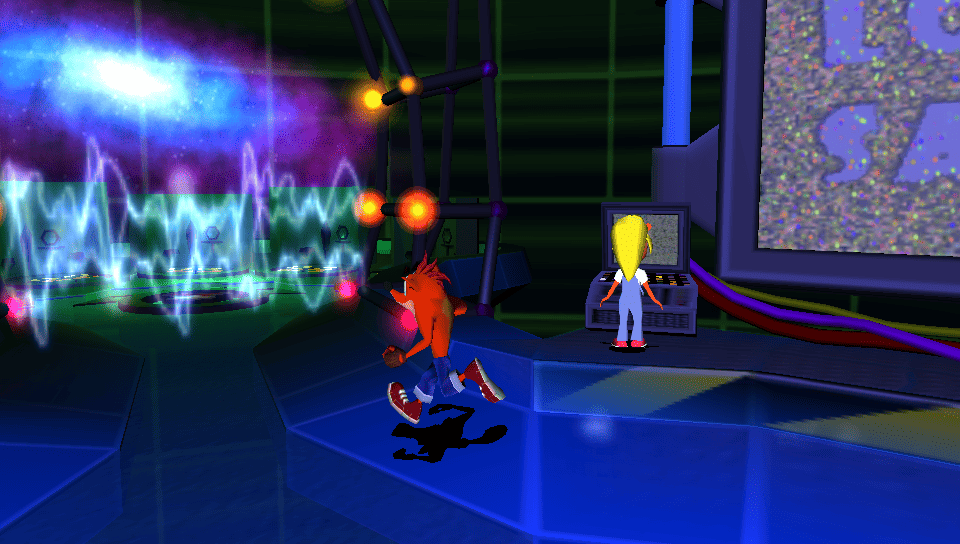
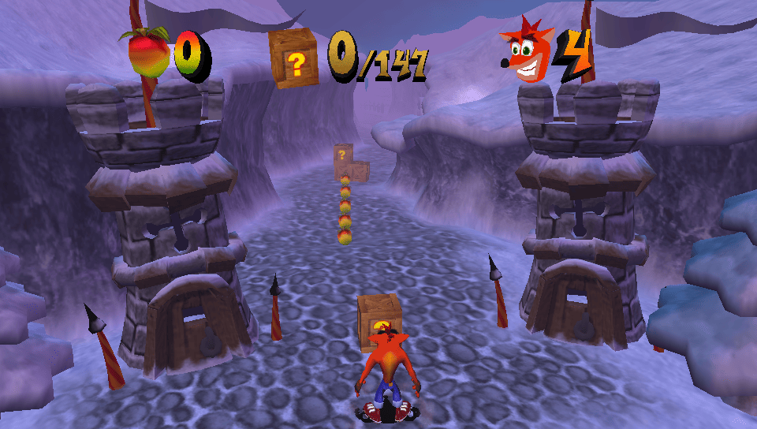
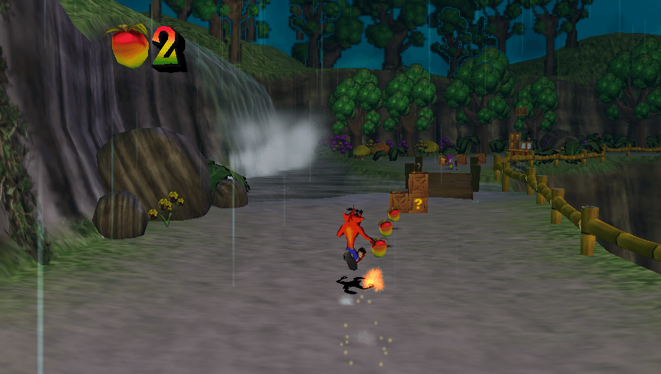
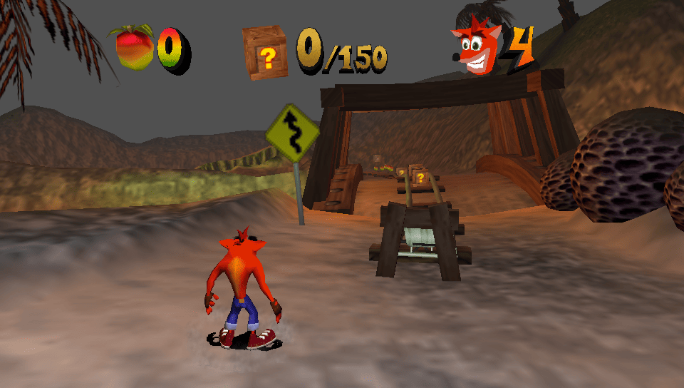
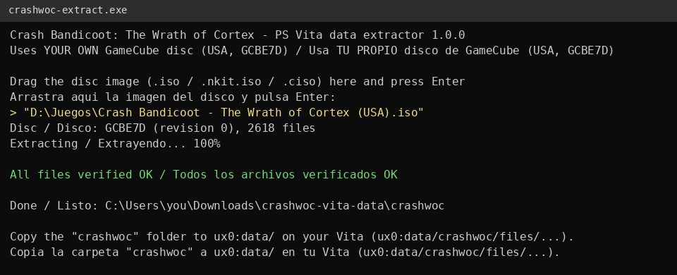
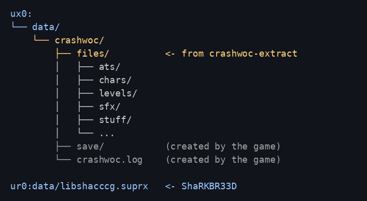

# Crash Bandicoot: The Wrath of Cortex — PS Vita port

**Unofficial** native PS Vita port of *Crash Bandicoot: The Wrath of Cortex*
(GameCube), built on the community decompilation. You need your own copy of
the game: this project contains **no game files**.

[Español](README.es.md)

| | |
|---|---|
|  |  |
|  |  |

## Status: beta

- The whole game can be played: hub, levels, bonus rounds, bosses, vehicles
  (mech, mine kart, buggy, glider...), saves, music and sound.
- 30–60 fps depending on the area. Busy scenes (lots of enemies, particles,
  steam) can drop below 30; **Select + D-pad down** locks the frame rate for
  steadier pacing.
- Known issues: some crushing platforms in *Earth Crisis* (`a\earth_r`) may
  not show up; loading a level takes ~8–13 s.
- Bug and performance reports are welcome (see [Reporting problems](#reporting-problems)).

## What you need

- A PS Vita or PS TV with **HENkaku / Enso** and **VitaShell**.
- **libshacccg.suprx** on the console (vitaGL compiles shaders at runtime).
  If you have never installed it, use
  [ShaRKBR33D](https://github.com/Rinnegatamante/ShaRKBR33D): install its VPK,
  run it once, and it extracts `ur0:data/libshacccg.suprx`.
- Your own dump of the **USA GameCube disc** (game ID `GCBE7D`): `.iso`,
  `.gcm`, `.nkit.iso` or `.ciso`. RVZ/WIA/GCZ images: convert them to ISO in
  Dolphin first (right click > *Convert File...* > *ISO*).
- About **1 GB** free on `ux0:`.

## Installation

1. **Download** from [Releases](../../releases): `crashwoc.vpk` and the
   extractor for your PC (`crashwoc-extract.exe` for Windows,
   `crashwoc-extract-linux` or `crashwoc-extract-macos`).
2. **Extract the game files**: drag your disc image onto
   `crashwoc-extract.exe` (or run it and drag the image into the window).
   It checks the disc and every file and creates the folder
   `crashwoc-vita-data/crashwoc` next to the extractor.
3. **Copy the `crashwoc` folder to `ux0:data/` on the Vita** (VitaShell: press
   *Select* for FTP, or *Start > USB*). The result must be
   `ux0:data/crashwoc/files/...`:

   

4. **Install `crashwoc.vpk`** with VitaShell (copy it to the Vita, press
   *Cross* on it, then *Install*).
5. Make sure `ur0:data/libshacccg.suprx` exists (see above), then start the
   game from the LiveArea bubble.

## Controls

| Vita | Game |
|---|---|
| Left stick | Move |
| Cross | GameCube A (jump) |
| Square | GameCube B (spin) |
| Circle / Triangle | GameCube X / Y |
| L / R | GameCube L / R |
| Select | GameCube Z |
| Start | Start / pause |
| Select + D-pad up | Screen mode: 4:3, stretched, widescreen (saved) |
| Select + D-pad down | Frame lock on/off (smoother pacing, may cap the frame rate) |

Saves: `ux0:data/crashwoc/save/`. Log: `ux0:data/crashwoc/crashwoc.log`.

## Troubleshooting

- **Black screen or crash at start**: `ur0:data/libshacccg.suprx` is missing,
  or the files are not at `ux0:data/crashwoc/files/` (check the folder layout).
- **The extractor says the disc is not GCBE7D**: only the USA disc works (the
  port contains code made from that executable).
- **The extractor reports files that differ**: the dump is damaged or
  modified; dump the disc again.
- **NKit image refused**: convert it back to ISO with NKit or Dolphin.

## Reporting problems

Open an issue with: what happened, the level, and
`ux0:data/crashwoc/crashwoc.log` (it includes performance numbers every
5 seconds).

## Building from source

See [docs/BUILDING.md](docs/BUILDING.md). In short: the decompilation is
downloaded from its own repository, the port's changes are applied as a patch
(`patches/decomp-port.patch`), and the build needs your own `main.dol`.

## How it works

The decompiled C runs natively on the Vita's ARM CPU; functions that are not
decompiled yet are translated from the game's PowerPC code at build time; the
GameCube graphics (GX) are emulated on top of OpenGL ES through vitaGL. See
[port/README.md](port/README.md) for the technical details.

## Credits

- The **Crash Bandicoot: The Wrath of Cortex decompilation** community:
  [denzi-gh/crashwoc-decomp-gc](https://github.com/denzi-gh/crashwoc-decomp-gc)
  and its contributors. This port would not exist without their work.
- [vitaGL](https://github.com/Rinnegatamante/vitaGL) and
  [ShaRKBR33D](https://github.com/Rinnegatamante/ShaRKBR33D) by Rinnegatamante.
- [VitaSDK](https://vitasdk.org) and the PS Vita homebrew community.
- [decomp-toolkit](https://github.com/encounter/decomp-toolkit) by encounter.

## Legal

This is an unofficial fan project, not affiliated with or endorsed by
Activision, Traveller's Tales, Nintendo or Sony. *Crash Bandicoot* is a
trademark of its owners. No game files are included: you must own the game
and use your own disc. The port's own code (`port/`, `extractor/`, `scripts/`)
is under the MIT license (see [LICENSE](LICENSE)); the decompilation is not part
of this repository.
